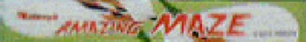
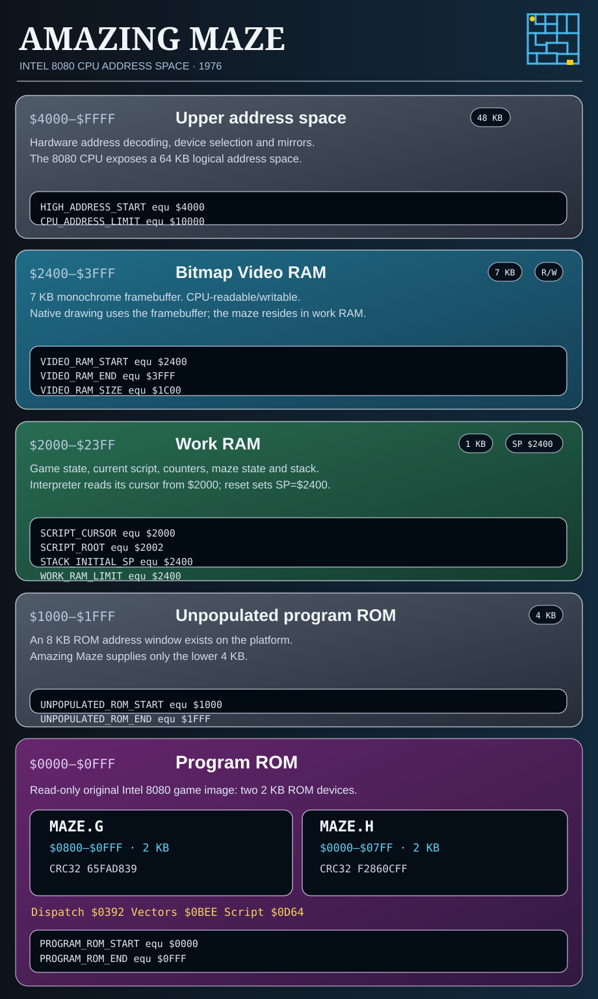

# Amazing Maze



Amazing Maze (1976) is an Intel 8080 arcade maze game by Dave Nutting Associates (DNA) / Midway. It challenges players to navigate generated mazes and is one of the company's earliest 8080 arcade programs. This project reconstructs the **original 4 KB executable** as readable native 8080 assembly, with every produced ROM chip verified against the original bytes.

**Amazing Maze contains a 17-command indexed native-handler interpreter.** Gun Fight (1975) contains 21 native command entries. Both games use one-byte commands, Intel 8080 handler vectors, and a script cursor at RAM `$2000`. Their command dictionaries share recognizable operations, including jumps, RAM updates, and conditional control flow. This RE traces DNA's engineering choices from Gun Fight into Amazing Maze.

The original game runs on the Midway 8080 black-and-white platform. It uses a 4 KB ROM image, 1 KB work RAM and a 7 KB monochrome framebuffer. The source of truth is the original ROM, not a previously generated assembly file. This reconstruction can freely replace its own intermediate labels, boundaries and source layout while preserving byte-exact executable behavior.

| | |
| --- | --- |
| [ROM identity and build](#rom-organization) | Two original 2 KB ROMs, native assembler and SHA-1 equality requirements. |
| [Indexed interpreter](#indexed-8080-execution-architecture) | Resident native command dispatcher, 17 vectors, script root and zero-token handling. |
| [Interrupts and timing](#interrupt-and-timer-services) | Original interrupt entry and periodic byte-counter service. |
| [Native code and graphics](#maze-engine-and-gameplay) | Maze engine, drawing, control flow and register contracts under hard RE. |
| [RAM, I/O and video](#rom-organization) | Device boundaries, work RAM, video RAM, and separately tracked I/O contracts. |
| [DNA lineage](#gun-fight-and-dna-lineage) | Comparison with Gun Fight and the later DNA 8080 indexed-command family. |

## Project layout

| Path | Contents |
| --- | --- |
| `roms/original/maze.zip` | Original reference MAME ROM archive |
| `src/maze.asm` | Target readable 8080 reconstruction — in progress |
| `build.sh`, `build.bat` | Native Linux/Windows build, ROM splitting, package and exact-hash gates |
| `tools/zmac`, `tools/zmac.exe` | Bundled native assembler binaries |
| `tools/scan-runtime.mjs` | Original-ROM CRC/SHA-1 and interpreter signature verification |
| `images/amazing-maze-21054-marquee.jpg` | Repository-owned image already present in the project |
| `images/amazing-maze-memory-map.svg` | CPU memory map using the Sea Wolf II visual conventions |
| `docs/NATIVE-RE-PASS.md` | Decoded native code, script control, timer services and register behavior |
| `docs/ORIGINAL-ROM-RUNTIME-SCAN.md` | Original static ROM decoder and vector inventory |
| `docs/8080-WORD-SEMANTICS.md` | Second hard RE pass, 17 handler entry contracts and startup packets |
| `docs/GUNFIGHT-COMPARISON.md` | Indexed VM architecture and reuse hypotheses |
| `docs/SPRINT-PLAN.md`, `docs/TECHNICAL-DEBT.md` | Remaining RE and verification work |

## Build

Both build scripts invoke the bundled native zmac assembler. **No Python is used in the build scripts.**

Linux:
```sh
./build.sh
```

Assembler command:
```sh
./tools/zmac -o src/maze.bin src/maze.asm
```

Windows 10/11:
```bat
build.bat
```

Assembler command:
```bat
tools\zmac.exe -o src\maze.bin src\maze.asm
```

The scripts follow Sea Wolf II's four-step build sequence:

1. Assemble the reconstructed Intel 8080 source into an exact 4,096-byte image.
2. Split that image into the original `maze.h` and `maze.g` 2 KB devices.
3. Verify each generated device against its original SHA-1.
4. Package `roms/maze.zip` only after the equality checks pass.

**Current source-build status:** `src/maze.asm` has not yet been fully recovered. Both scripts report `BLOCKED` until it exists. They do not substitute the reference ROM for generated output. ROM assembly, exact equality, MAME and physical hardware are distinct verification gates.

## Run in MAME

After a byte-exact source build:

```sh
mame maze -window -skip_gameinfo -rompath roms
```

## ROM organization

The original 4 KB program occupies two 2 KB devices in the lower half of the Midway 8080 ROM window.

| ROM | CPU address | CRC32 | SHA-1 |
| --- | --- | --- | --- |
| `maze.h` | `$0000–$07FF` | `f2860cff` | `62b3fd3d04bf9c5dd9b50964374fb884dc0ab79c` |
| `maze.g` | `$0800–$0FFF` | `65fad839` | `893f0a7621e7df19f777be991faff0db4a9ad571` |

The memory map illustrates ROM chip boundaries, the unused upper ROM window, work RAM, bitmap video RAM, and higher-address decoder regions requiring additional hardware verification.



## Indexed 8080 execution architecture

Amazing Maze uses one-byte game commands to select little-endian Intel 8080 native handler addresses. Gun Fight uses the same overall command-dispatch architecture. Amazing Maze adds explicit nonzero command bounds checking and a dedicated zero-command event path.

| Component | Address | Function |
| --- | --- | --- |
| Reset | `$0000` | Initializes `SP=$2400` and branches to `$0017` |
| Interrupt entry | `$0008` | Saves PSW, BC, DE, HL and enters service at `$030B` |
| Script root | `$0D64` | Initially stored at RAM `$2002` |
| Script cursor | RAM `$2000` | Current game command pointer |
| Interpreter | `$0392–$03C9` | Loads, bounds-checks and dispatches one-byte tokens |
| Zero-command path | `$03CA` | Conditional event call rather than normal native slot |
| Vector table | `$0BEE–$0C0F` | 17 little-endian handler addresses |

### Native command dispatch

The normal token path advances the pointer at RAM `$2000`, changes the one-based command number into a zero-based vector index, checks the 17-entry limit, and indirectly jumps to the native code.

```asm
; Actual original instruction sequence at $03C0.
; HL initially holds $0BEE; A contains the zero-based token.
ADD A           ; $87: vector index * 2
MOV C,A         ; $4F
MVI B,0         ; $06 $00
DAD B           ; $09: HL += BC
MOV A,M         ; $7E: low native target byte
INX H           ; $23
MOV H,M         ; $66: high target byte
MOV L,A         ; $6F
PCHL            ; $E9: jump to original native handler
```

Command `$00` enters the event path at `$03CA`, where RAM `$201F` controls a conditional call to `$03D4`. Nonzero commands `$01–$11` select the 17 native vectors. Higher command values enter initialization at `$0377`. These details come from the original Intel 8080 instructions.

[17-command native dictionary](docs/8080-WORD-SEMANTICS.md) · [Original command vectors and ROM signatures](docs/ORIGINAL-ROM-RUNTIME-SCAN.md) · [Native assembly analysis](docs/NATIVE-RE-PASS.md)

## Interrupt and timer services

The `$0008` entry saves the primary 8080 registers before transferring to native frame service. A timed event service beginning at `$0341` operates on work-RAM counters: `$200A` reloads with `$3C`, and the helper at `$0369` decrements four neighboring bytes at `$200B–$200E`. The helper aggregates expiry information into register `B`.

These are observed native register and RAM behaviors; their exact game-time meaning awaits a complete scheduler trace. See [the detailed service disassembly](docs/NATIVE-RE-PASS.md).

## Maze engine and gameplay

The game-specific hard RE covers maze representation, maze generation/randomness, drawing and collision, controls, timed play, opponent behavior and scoring. The original program stream at `$0D64` contains real native-interpreted data; packet widths must be established from individual handlers before translating it into named game commands.

In particular, the original maze-generation experiment attributed to Jeff Frederiksen must be compared against the commercial game's executable routines rather than assumed to be a separate or inherited module.

## Gun Fight and DNA lineage

Gun Fight (1975) introduced the earlier recovered DNA Intel 8080 indexed-command architecture. Its interpreter runs at `$03A7`, uses a 21-entry native command table at `$09AE`, and reads scripts through RAM `$2000`. Amazing Maze (1976) uses a 17-entry native table at `$0BEE`, dispatcher `$0392–$03C9`, and the **same script cursor address `$2000`**.

### Shared command functions

The two games contain corresponding native command operations with different command numbers:

| Command function | Gun Fight command / handler | Amazing Maze command / handler | Common operation |
| --- | --- | --- | --- |
| **GOTO_SCRIPT** | `$09 / $0682` | `$0B / $0B7B` | Read a 16-bit command-stream address and store it at `$2000` |
| **Set RAM byte** | `$02 / $063D`, `$03 / $0649` | `$08 / $0B5F`, `$0C / $0B84` | Read an immediate byte and update game state in RAM |
| **Conditional execution** | `$05 / $068D`, `$06 / $069D`, `$10 / $0807` | `$0E / $0BB9`, `$0F / $0BC4` | Test game state and conditionally change execution |
| **Display/graphics services** | `$01 / $05E9`, `$0E / $0785`, `$0F / $07AB` | `$04 / $0B17`, `$07 / $0B90`, `$10 / $0BCF` | Work with inline data, memory addresses and native drawing-related services |

**The strongest common word is `GOTO_SCRIPT`.** Both implementations use a little-endian 16-bit target and replace the command pointer at `$2000`. RAM-store and conditional commands demonstrate shared command families with game-specific operands and handlers. Graphics commands remain a broader functional comparison while the detailed drawing routines are recovered.

### How the interpreter evolved

| Feature | Gun Fight | Amazing Maze |
| --- | --- | --- |
| Native command slots | 21 (`$00–$14`) | 17 (`$01–$11`) plus zero event |
| Script cursor | RAM `$2000` | RAM `$2000` |
| Command vector base | `$09AE` | `$0BEE` |
| Script starting point | `$0821` | `$0D64` |
| Zero-command operation | Counter-based wait/repeat handler | Separate `$03CA` event path |
| Indexed native dispatch | Address table and indirect transfer | Address table, range check and indirect transfer |

**Current RE finding:** DNA used the same indexed-command design and retained several command functions while changing the word vocabulary, token layout and event handling for Amazing Maze. The [native comparison](docs/GUNFIGHT-COMPARISON.md) traces these correspondences through their original 8080 routines.

[Gun Fight ↔ Amazing Maze command comparison](docs/GUNFIGHT-COMPARISON.md) · [Amazing Maze word dictionary](docs/8080-WORD-SEMANTICS.md) · [Sprint plan](docs/SPRINT-PLAN.md)

## Sources and evidence

Original ROM identities and runtime bytes are recorded in `docs/ORIGINAL-ROM-RUNTIME-SCAN.md` and the further native pass. Hardware and chronology research will be reconciled with original manuals, schematics and the MAME Midway 8080 driver. Research findings and unverified hypotheses are documented separately from executable observations.
