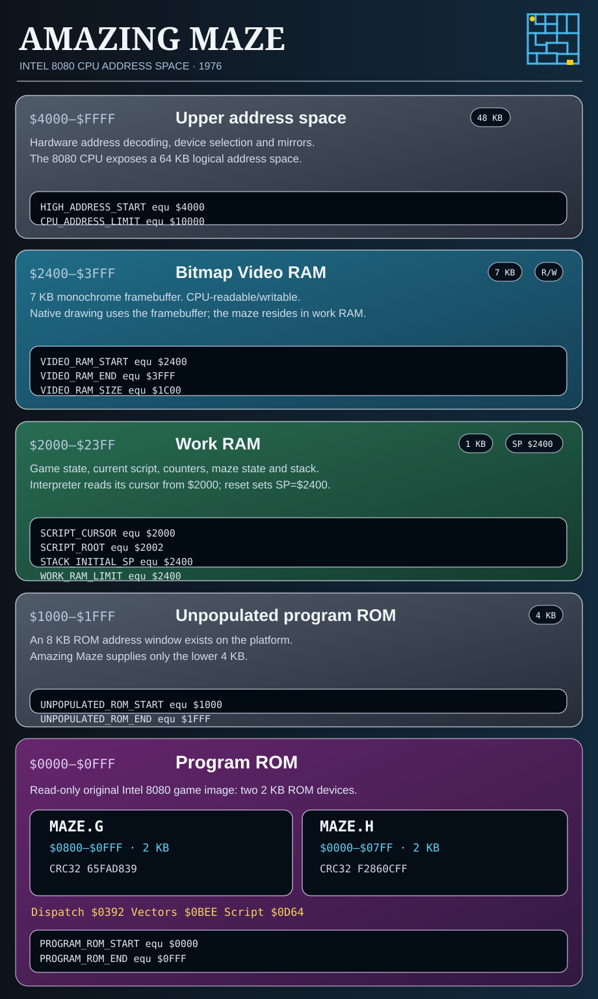

# Amazing Maze Intel 8080 memory map

The original resident program occupies two 2 KB ROM devices, `maze.h` at $0000–$07FF and `maze.g` at $0800–$0FFF. Working RAM and display RAM occupy the 8080 game board's mapped regions.

| Address | Device or region | Function |
| --- | --- | --- |
| $0000–$07FF | maze.h | Reset and interrupt entries; command interpreter at $0392 |
| $0800–$0FFF | maze.g | Native handlers, command vector table and scripts |
| $1000–$1FFF | Unmapped | Outside original program ROM |
| $2000–$23FF | Working RAM | Command cursor, script root and game state |
| $2400–$3FFF | Video RAM | Bitmap display storage |
| $4000–$7FFF | Unmapped | Outside the principal game memory regions |

## Verified program landmarks

| Address | Function |
| --- | --- |
| $0000 | Reset entry; stack initialization and jump to $0017 |
| $0008 | Saved-register service entry |
| $037C | Initial script root setup |
| $0392–$03C9 | One-byte command fetch and vector dispatch |
| $03CA | Separate zero-command control path |
| $0BEE–$0C0F | 17 little-endian native handler pointers |
| $0D64 | Initial command stream root |

The original ROM member hashes are `maze.h` SHA-1 `62b3fd3d04bf9c5dd9b50964374fb884dc0ab79c` and `maze.g` SHA-1 `893f0a7621e7df19f777be991faff0db4a9ad571`.

See [original ROM runtime scan](ORIGINAL-ROM-RUNTIME-SCAN.md) for all 17 handler targets and byte signatures.
